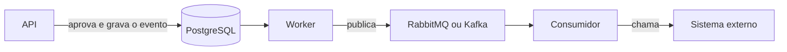

# Gestão de Solicitações Internas — API


Sistema para centralizar o cadastro, o acompanhamento e a decisão de solicitações internas (compras, acessos, demandas entre áreas etc.).

| Repositório | Conteúdo |
|---|---|
| **gestao-solicitacoes-internas-api** (este) | API REST em NestJS, banco PostgreSQL, migrations com Flyway e Docker |
| [gestao-solicitacoes-internas-web](https://github.com/PHSouthier/gestao-solicitacoes-internas-web) | Front-end em Next.js |

---

## Sumário

1. [Tecnologias](#%EF%B8%8F-tecnologias)
2. [Como executar](#%EF%B8%8F-como-executar)
3. [Documentação da API](#-documenta%C3%A7%C3%A3o-da-api)
4. [Documentação complementar](#-documenta%C3%A7%C3%A3o-complementar)
5. [Testes](#-testes)
6. [Considerações arquiteturais](#-considera%C3%A7%C3%B5es-arquiteturais)
7. [Autor](#-autor)

---

## ✔️ Tecnologias

| Camada | Tecnologia |
|---|---|
| Runtime | Node.js 24 · TypeScript |
| Framework | NestJS 12 |
| Banco | PostgreSQL 17 |
| Migrations | Flyway 13 |
| Acesso a dados | Prisma 7 |
| Autenticação | JWT · login com Google |
| Documentação | Swagger |
| Testes | Vitest |
| Containers | Docker |

---

## 🛠️ Como executar

Para ter uma cópia do projeto rodando localmente, siga os passos abaixo.

### Pré-requisitos

- Git
- Docker e Docker Compose
- Node.js 24 e npm (só para rodar fora do Docker ou executar os testes)

### Configuração

1. Clone os dois repositórios **na mesma pasta** (o compose da API usa a pasta do front para montar a imagem dele):

   ```bash
   git clone https://github.com/PHSouthier/gestao-solicitacoes-internas-api.git
   git clone https://github.com/PHSouthier/gestao-solicitacoes-internas-web.git
   ```

2. Crie o arquivo `.env` da API a partir do exemplo. Os valores do `.env.example` já funcionam para rodar localmente:

   ```bash
   cd gestao-solicitacoes-internas-api
   cp .env.example .env
   ```

3. Suba a solução completa (banco, migrations, API e front) com o Docker Compose:

   ```bash
   docker compose --profile full up -d --build
   ```

   Sem o `--profile full`, sobem só o banco, as migrations e a API. Nesse caso, o front pode ser iniciado pelo compose do [repositório web](https://github.com/PHSouthier/gestao-solicitacoes-internas-web).

4. Com os containers no ar, os serviços ficam disponíveis nos endereços:

   - Aplicação (front): `http://localhost:3000`
   - API: `http://localhost:3001/api/v1`
   - Swagger: `http://localhost:3001/api/docs`
   - Healthcheck: `http://localhost:3001/api/v1/health`
   - PostgreSQL: `localhost:5433`

### Rodando a API fora do Docker

1. Crie o `.env` (passo 2 acima), suba o PostgreSQL e aplique as migrations:

   ```bash
   docker compose up -d flyway
   ```

2. Instale as dependências (isso também gera o cliente do Prisma):

   ```bash
   npm install
   ```

3. Rode a API em modo desenvolvimento, que recarrega a cada alteração:

   ```bash
   npm run start:dev
   ```

   A API fica disponível em `http://localhost:3001`.

### Usuários de teste

Criados pelo seed. Todos com a senha **`Senha@123`**.

| Perfil | E-mail | Pode |
|---|---|---|
| Solicitante | `solicitante@empresa.local` | cadastrar; editar e excluir as próprias solicitações |
| Analista | `analista@empresa.local` | tudo do solicitante em qualquer solicitação (menos excluir), analisar e decidir |
| Administrador | `admin@empresa.local` | tudo, inclusive alterar o perfil de outros usuários |

Também é possível criar uma conta pela tela de cadastro; ela nasce com perfil Solicitante.

---

## 📜 Documentação da API

A API é documentada com **Swagger** (OpenAPI), gerado a partir do próprio código. Pelo Swagger UI é possível ver todos os endpoints, os dados de entrada e saída, os erros possíveis de cada rota e testar as requisições direto pelo navegador.

### 🔹 Acessando a documentação

Com a API rodando, a documentação fica disponível em:

- **Swagger UI**: [http://localhost:3001/api/docs](http://localhost:3001/api/docs)
- **Especificação OpenAPI (JSON)**: [http://localhost:3001/api/docs-json](http://localhost:3001/api/docs-json)

---

## 📌 Documentação complementar

Os detalhes do projeto estão em arquivos separados, na pasta [`docs`](docs):

| Documento | Conteúdo |
|---|---|
| [Premissas e regras de negócio](docs/premissas-e-regras-de-negocio.md) | Fluxo de status, regras e permissões por perfil |
| [Decisões técnicas](docs/decisoes-tecnicas.md) | O que foi escolhido e por quê: arquitetura, banco, segurança, API e documentação, qualidade e infraestrutura |
| [Status da entrega](docs/status-da-entrega.md) | Implementado, pendente e como seria implementado, critérios de priorização e próximos passos |

---

## 📊 Testes

```bash
npm test
```

**80 testes unitários (Vitest)**, sem banco, cobrindo as partes com regra:

| Área | O que garante |
|---|---|
| Solicitações (service) | cadastro, edição, exclusão, decisão, área "Outras", permissão do solicitante, alteração simultânea |
| Máquina de estados | todas as transições permitidas e proibidas; estados finais |
| AuthGuard | rota pública, 401 sem login, token inválido ou expirado, 403 por perfil |
| AuthService | login válido e inválido, usuário inativo, os caminhos do login com Google |
| Filtro de erros | formato padrão, erros por campo, 500 sem vazar a mensagem interna |
| DTOs | validações do cadastro de usuário, do cadastro e da listagem de solicitações |
| Usuários, dashboard e health | e-mail duplicado, perfil próprio, cálculo dos indicadores, banco fora do ar |

O fluxo completo (navegador → front → API → banco) é coberto pelos testes **Playwright** do [repositório web](https://github.com/PHSouthier/gestao-solicitacoes-internas-web#-testes).

---

## 🧩 Considerações arquiteturais

### Evolução da solução

**Quais mudanças arquiteturais seriam necessárias para suportar o crescimento da solução?**

- **Várias instâncias da API e do front atrás de um load balancer**, com *auto scaling* conforme a carga.
- **Mensageria com RabbitMQ ou Kafka** para tirar do fluxo principal o que pode rodar em segundo plano: integrações, notificações e relatórios.
- **Workers separados** para consumir as filas, escalando independente da API.
- **Cache com Redis** para os indicadores do dashboard e as listas que mudam pouco.

**Quais seriam os principais riscos técnicos identificados?**

- **Lentidão na busca e na listagem** com muitos registros. Mitigação: índices no banco e paginação, que já é obrigatória.
- **Banco como ponto único de falha.** Mitigação: PostgreSQL gerenciado com alta disponibilidade e backups automáticos.
- **Front e API se desencontrarem** quando um mudar o contrato. Mitigação: tipos gerados a partir do Swagger e checagem no CI.
- **Pouca visibilidade de erros em produção.** Mitigação: logs centralizados, métricas e alertas.
- **Autenticação própria** (senhas, recuperação, bloqueio). Mitigação: limite de tentativas no login e, depois, um provedor corporativo.

**Como garantir escalabilidade, disponibilidade e manutenibilidade da aplicação?**

- **Escalabilidade:** load balancer, auto scaling, cache com Redis, filas com RabbitMQ ou Kafka e réplicas de leitura do banco.
- **Disponibilidade:** pelo menos duas instâncias de cada serviço, banco com alta disponibilidade, healthcheck e deploy sem parada.
- **Manutenibilidade:** o padrão que já existe (mesmas camadas em todos os módulos, regras testadas, migrations versionadas, API versionada e documentada no Swagger), mais CI rodando testes a cada alteração.

**Quais componentes ou camadas poderiam ser adicionados em uma evolução futura da arquitetura?**

- **API Gateway** (roteamento, autenticação e limite de requisições).
- **Message broker** (RabbitMQ ou Kafka) e **workers**.
- **Redis** para cache.
- **Observabilidade:** Prometheus e Grafana para métricas, e ELK ou Loki para logs.
- **Serviço de notificações** (e-mail ou Teams).
- **Armazenamento de arquivos** (como o S3) para anexos.

### Integração com sistemas externos

Cenário: após a aprovação de uma solicitação, um sistema corporativo externo precisa ser comunicado automaticamente.

**Como realizaria esta integração?**

De forma **assíncrona, com mensageria**:



Ao aprovar, a API grava a decisão e um evento `solicitacao.aprovada` na mesma transação. Um worker publica esse evento na fila, e um consumidor chama o sistema externo. Assim, a aprovação nunca fica sem o evento, e a API não depende do sistema externo para responder.

**Quais padrões ou tecnologias utilizaria?**

- **RabbitMQ ou Kafka** para as filas.
- **Retry** com intervalo crescente entre as tentativas.
- **Dead letter queue (DLQ)** para os eventos que falharem de vez.
- **Idempotência:** cada evento tem um id único, para o sistema externo ignorar repetições.
- **Circuit breaker**, para parar de chamar um sistema que está fora do ar.

**Como trataria falhas de comunicação?**

- O evento fica na fila e é **reenviado automaticamente**, com intervalo crescente entre as tentativas.
- Depois de algumas tentativas, vai para a **DLQ**.
- Corrigida a causa, os eventos da DLQ podem ser **reprocessados**.
- Com o **circuit breaker**, os envios param por um tempo quando o sistema externo está fora, em vez de insistir.

**Como garantiria rastreabilidade das operações realizadas?**

- **Id de correlação:** o `x-request-id` que a API já gera acompanha o evento até o sistema externo.
- **Registro de cada tentativa de envio** (data, resultado e erro).
- **Histórico da solicitação**, que já registra quem mudou o status, quando e com qual comentário.
- **Logs centralizados**, pesquisáveis pelo id do evento ou da requisição.

**Como evitaria impacto na experiência do usuário caso o sistema externo estivesse indisponível?**

Se o sistema externo estiver fora do ar, os eventos ficam na fila e são entregues quando ele voltar. O usuário continua trabalhando normalmente e pode ver, na tela da solicitação, se a integração está pendente ou se já foi finalizada.

---

# 👨‍💻 Autor

| [<br><sub>Pedro Henrique Southier</sub>](https://github.com/PHSouthier) |
| :--------------------------------------------------------------------------------------------------------------------------------------------------------------: |
