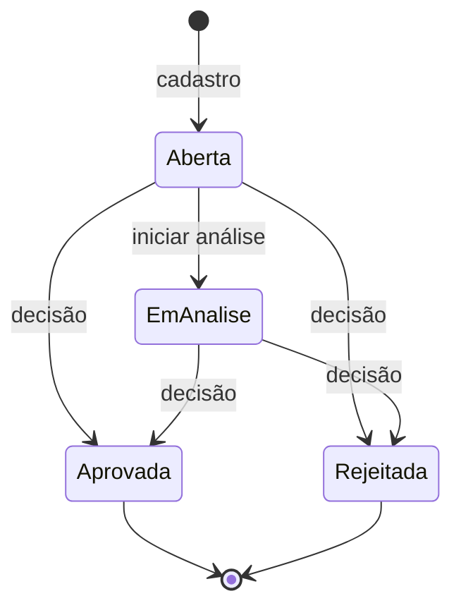

# 📌 Premissas e regras de negócio

[⬅️ Voltar ao README](../README.md)

## Fluxo de status

1. **Toda solicitação nasce Aberta.** O status só muda pelo fluxo de análise e decisão, nunca pela edição.
2. **Aprovada e Rejeitada são finais:** não podem ser editadas, excluídas nem mudar de status.
3. **A decisão exige comentário** (5 a 1000 caracteres). Comentário, autor e data ficam no histórico.
4. **Toda mudança de status gera um registro no histórico**, inclusive a criação.
5. **A análise é opcional:** um analista pode decidir direto uma solicitação Aberta.
6. **A exclusão é lógica** e só é permitida com status Aberta. A solicitação continua no banco para auditoria, mas some da listagem e do dashboard.

## Perfis

| Ação | Solicitante | Analista | Administrador |
|---|:-:|:-:|:-:|
| Listar, ver detalhe, dashboard | ✅ | ✅ | ✅ |
| Cadastrar | ✅ | ✅ | ✅ |
| Editar (não finalizada) | só as próprias | ✅ | ✅ |
| Excluir (só Aberta) | só as próprias | ❌ | ✅ |
| Iniciar análise e decidir | ❌ | ✅ | ✅ |
| Gerenciar perfis de usuários | ❌ | ❌ | ✅ (menos o próprio) |

## Veja também

- [Decisões técnicas](decisoes-tecnicas.md): como essas regras foram implementadas (máquina de estados, exclusão lógica, guard global com perfis).
- [Status da entrega](status-da-entrega.md): o que foi implementado e o que ficou pendente.
